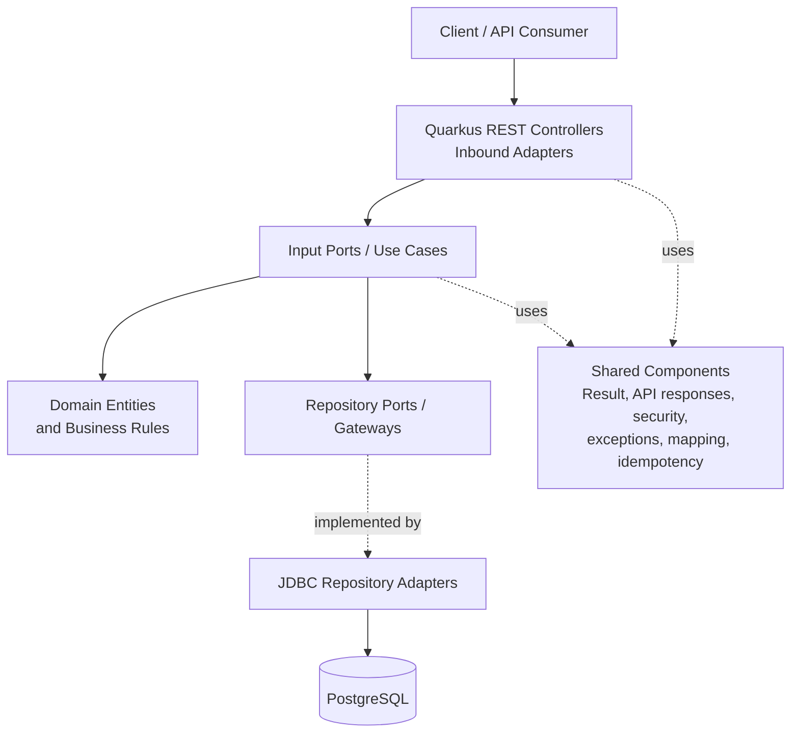
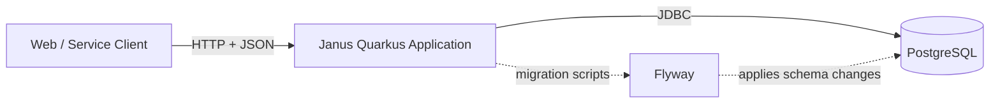
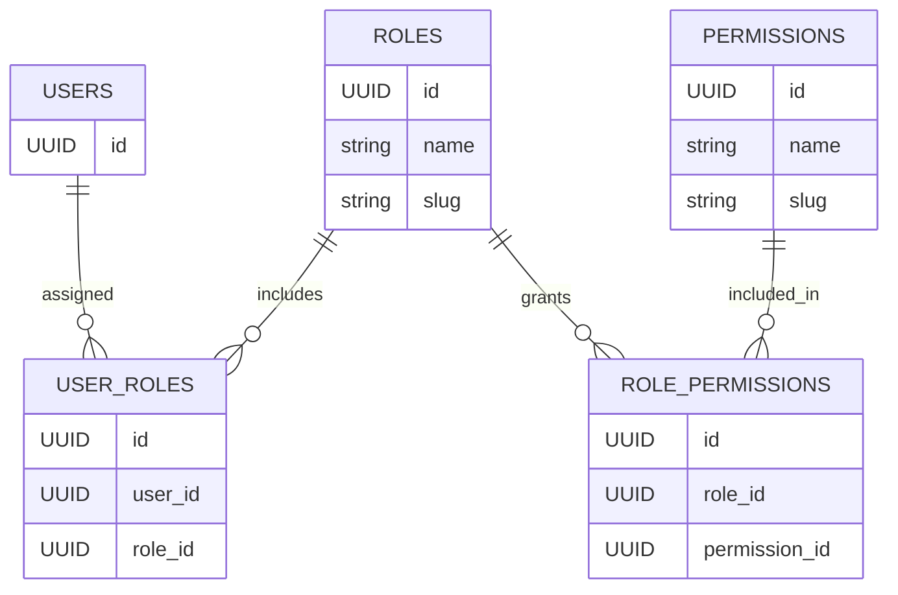
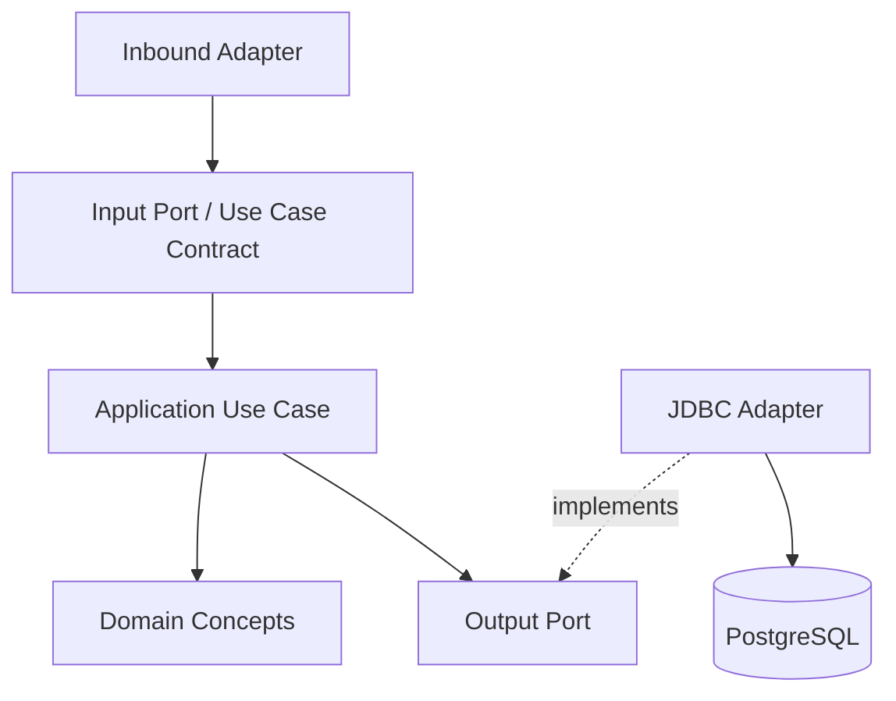
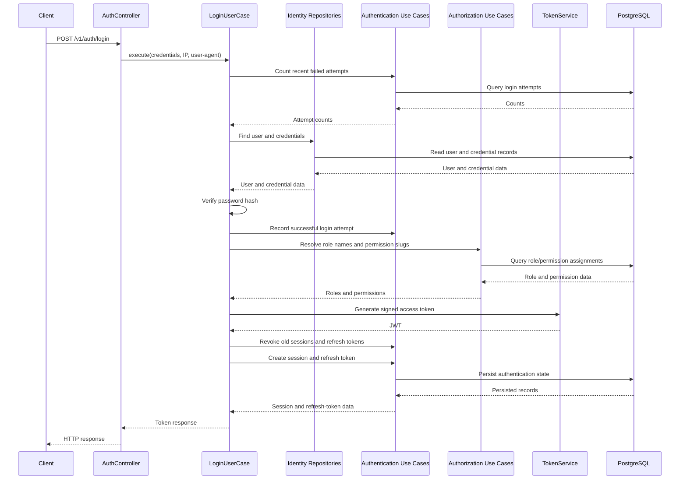

# Janus Architecture

## 1. Overview

Janus is an identity and access management (IAM) API built with Java and Quarkus. Its codebase is organized as a
**modular monolith**: the modules run in one application and currently share a PostgreSQL database, while each module
groups a specific area of the domain.

The project follows a **hexagonal-architecture-inspired** organization. HTTP controllers act as inbound adapters,
application use cases coordinate business operations, domain entities represent core concepts, and repository interfaces
separate application logic from JDBC persistence implementations. The exact package names vary between modules, so the
structure should be understood as a common architectural direction rather than a perfectly uniform implementation.

Main architectural goals:

- Keep identity, authorization, authentication, and reliability responsibilities grouped by module.
- Keep REST and persistence concerns outside application use cases where practical.
- Use PostgreSQL for durable state and Flyway for schema migrations.
- Represent expected application outcomes with a shared `Result<T>` type.
- Centralize shared concerns such as API responses, exception handling, mapping, security utilities, and idempotency
  support.

## 2. High-Level Architecture

The diagram represents the intended separation of responsibilities. Some modules use slightly different package names
and dependency directions, and the implementation is not a strict enforcement of every hexagonal-architecture rule.

## 3. Runtime and Deployment Shape

Janus is built as a Quarkus application with Maven. It is deployed as one runtime rather than as independently deployed
microservices.

PostgreSQL is configured as the datasource, and Flyway migrations are configured to run at application startup. The
repository implementations use JDBC rather than a conventional JPA/Hibernate entity persistence model.

The project includes Quarkus extensions for health checks, OpenAPI, Micrometer/Prometheus metrics, OpenTelemetry, Kafka
messaging, mail, and scheduled tasks. The presence of an extension alone does not mean every integration is fully wired
into a working end-to-end flow; see [Implementation Boundaries](#10-implementation-boundaries-and-follow-up-work).

## 4. Module Responsibilities

### 4.1 Identity

**Package:** `org.janus.modules.identity`

Owns user identity and credential-related behavior, including:

- User registration, lookup, update, and deletion operations.
- User credential storage and verification through a password-encoder abstraction.
- Login orchestration and access-token generation.
- REST controllers for authentication, users, and user credentials.

The login use case coordinates with the authorization and authentication modules to collect role and permission
information, record login attempts, manage sessions, and issue refresh-token state.

### 4.2 Authorization

**Package:** `org.janus.modules.authorization`

Implements role-based access-control data and operations:

- Roles.
- Permissions.
- User-to-role assignments.
- Role-to-permission assignments.
- Queries for roles and permission slugs used when generating access tokens.

The authorization model can be represented as:

This is a conceptual relationship diagram, not a full database schema. Refer to the Flyway migration files and
repository SQL for the exact columns and constraints.

### 4.3 Authentication

**Package:** `org.janus.modules.authentication`

Contains state and use cases related to authentication lifecycle management:

- Sessions and session revocation.
- Refresh-token records and revocation.
- Successful and failed login-attempt tracking.
- Queries used to detect repeated failed login attempts.

The login use case currently checks the number of failed attempts within a time window before validating credentials.
The implementation defines a threshold of three failures and a 15-minute lockout window for the relevant user/IP checks.

### 4.4 Reliability

**Package:** `org.janus.modules.reliability`

Contains the Inbox-related model, use cases, JDBC repository, and an adapter that connects Inbox records to the shared
idempotency service. Inbox records are identified by a message key and consumer group, with a database uniqueness
constraint on that pair.

An Outbox table migration is present. However, the current `OutboxController` is empty, and the source inspected does
not contain a complete Outbox repository/use-case/publishing flow. The Outbox schema should therefore be treated as
groundwork rather than evidence of a finished event-publishing mechanism.

### 4.5 Bootstrap

**Package:** `org.janus.modules.bootstrap`

`ApplicationBootstrap` listens for the Quarkus startup event and runs initialization use cases for system roles,
permissions, role-permission relationships, a master user, and the user's role assignments.

Bootstrap values are configured in `application.yaml`. Initial credentials must be replaced or supplied securely for
each environment; default or sample credentials must never be reused in production.

### 4.6 Shared and Configuration Packages

**Packages:** `org.janus.shared` and `org.janus.configs`

These packages provide cross-cutting infrastructure and API conventions, including:

- A `Result<T>` abstraction and common HTTP response objects.
- Base DTO, entity, filter, repository, and use-case abstractions.
- Shared exceptions and global exception handling.
- Password-encoding abstractions and security-related utilities.
- Idempotency infrastructure and annotations.
- MapStruct mapper configuration and custom conversion helpers.
- Jackson/media-type configuration.

Shared code is intended for concerns used by multiple modules. Domain-specific decisions should remain in the owning
module where possible.

## 5. Internal Module Organization

The codebase uses the following recurring concepts, although the exact package names vary slightly between modules:

| Concept               | Responsibility                                                   | Common package names                                       |
|-----------------------|------------------------------------------------------------------|------------------------------------------------------------|
| Inbound adapter       | Accepts HTTP requests and translates them into application calls | `adapter.in.web`                                           |
| Input port            | Describes an application operation exposed to a caller           | `ports.in`, `port.in`, or module-specific gateway packages |
| Application use case  | Coordinates business operations and dependencies                 | `application`                                              |
| Domain entity         | Represents a business concept and its state                      | `domain.entity`                                            |
| Output port           | Abstracts a dependency such as persistence                       | `ports.out`, `port.out`, or repository/gateway interfaces  |
| Outbound adapter      | Implements a port using a technical integration                  | `adapter.out.persistence.repository`                       |
| Shared infrastructure | Provides reusable technical concerns                             | `org.janus.shared`, `org.janus.configs`                    |

A simplified dependency direction is:

Repository interfaces make persistence replaceable in principle, while JDBC adapters contain SQL and database-specific
behavior. Cross-module calls exist where a use case needs another module's capability; these integrations should remain
explicit to avoid accidental coupling.

## 6. Example Request Flow: Login

The following sequence summarizes the login path implemented by the identity module and its collaborators.

This is a conceptual view of the current login implementation; exact repository calls and transaction boundaries are
defined in the code. Failed attempts follow error paths that record the attempt and return an appropriate failure
result.

The access token is signed using an RSA-based JWT implementation. The token-generation code adds claims for the user
subject, username, email, groups/roles, and permission slugs. The configured token lifetime and verification settings
should be reviewed together before deployment.

## 7. Persistence and Schema Evolution

- **Database:** PostgreSQL.
- **Persistence approach:** JDBC repository adapters with explicit SQL.
- **Migrations:** Flyway scripts under `src/main/resources/db/migrations`.
- **Migration startup behavior:** configured to migrate at application startup.
- **Identifiers:** UUIDs are used by many persisted entities.
- **Integrity:** migrations define primary keys, foreign keys, unique constraints, checks, and indexes for the relevant
  tables.

The migration set includes schema setup and tables for Inbox processing, password history, audit logs, Outbox events,
API keys, login attempts, and additional token-related records. A table existing in a migration does not necessarily
mean its feature has a complete application service or API implementation.

Schema changes should be added as new versioned migrations rather than by editing migrations that have already been
applied to shared environments.

## 8. API and Error Handling

REST endpoints use Quarkus REST/JAX-RS annotations and exchange JSON. Controllers generally invoke application
operations and translate the returned `Result<T>` into an HTTP response, using shared response objects and common
exception handling where appropriate.

This gives the application a consistent place to represent successful outcomes and expected failures. The exact HTTP
status and response payload remain operation-specific; consult the relevant controller and DTO before relying on a
particular endpoint contract.

OpenAPI support is included as a dependency. The generated API specification is the best source for the live endpoint
contract when the application is running and the relevant resources are registered.

## 9. Security Design Notes

The current implementation includes several security-related mechanisms:

- RSA-signed JWT access tokens.
- User roles and permission slugs included in generated token claims.
- Password verification through a shared encoder abstraction; the project includes an Argon2 library dependency.
- Persisted sessions and refresh-token records, with use cases for revocation.
- Login-attempt tracking and temporary blocking logic.
- Authentication guards on multiple protected REST resources.
- Idempotency annotations on registration, login, and logout-all operations.

These features should not be interpreted as a complete security audit. Before production use, validate authorization
policy enforcement on every protected operation, refresh-token storage and rotation semantics, secret/key management,
audit coverage, rate limiting, and behavior under concurrent requests.

**Configuration item to resolve:** `TokenService` sets the JWT issuer to `https://janus.api`, while `application.yaml`
contains different issuer values in the JWT verification configuration. Align the signing and verification issuer
settings so valid tokens are not rejected and untrusted tokens cannot be accepted due to ambiguous configuration.

The current configuration also declares bootstrap account values in `application.yaml`. Move environment-specific
credentials and cryptographic key material to environment variables or a secrets manager before deploying outside a
local development environment.

## 10. Implementation Boundaries and Follow-Up Work

The following items are visible in the inspected source snapshot and should be verified before describing them as
complete features:

1. **Session REST API:** `SessionController` is currently an empty class. Session-related use cases and JDBC
   repositories exist, but this controller does not expose session endpoints yet.
2. **Outbox processing:** the Outbox migration exists, but `OutboxController` is empty and a complete Outbox
   persistence/publishing workflow was not found in the inspected source.
3. **Messaging integration:** the Quarkus Kafka extension is present, but no active `@Incoming` or `@Outgoing` messaging
   endpoints were found in the Java source inspected.
4. **JWT issuer configuration:** issuer values are inconsistent and should be aligned.
5. **Bootstrap secrets:** bootstrap credentials and key handling need environment-safe configuration before production
   deployment.
6. **Architecture consistency:** package naming and module boundaries differ across modules. Keeping port, use-case,
   domain, and adapter conventions consistent would make the intended architecture easier to follow and test.

These points describe the inspected repository snapshot, not necessarily future work or changes made after this
snapshot.

## 11. Suggested Architecture Evolution

A practical path forward would be to:

1. Align JWT signing and verification configuration and externalize bootstrap secrets.
2. Complete or remove placeholder endpoints so that the public API matches implemented behavior.
3. Define and test the full Inbox idempotency lifecycle, including how processing failures and retries are handled.
4. If Outbox is required, implement its persistence port, publisher/worker, retry policy, and observability as one
   end-to-end feature.
5. Standardize module package conventions and document cross-module dependencies.
6. Add integration tests for login, token revocation, authorization decisions, and transactional failure scenarios.

The goal is not to introduce extra architectural layers for their own sake; it is to make the existing boundaries
explicit, testable, and useful as the project grows.

## 12. Relevant Source Locations

| Area                                        | Location                                          |
|---------------------------------------------|---------------------------------------------------|
| Quarkus and dependency configuration        | `pom.xml`                                         |
| Application configuration                   | `src/main/resources/application.yaml`             |
| Database migrations                         | `src/main/resources/db/migrations/`               |
| Identity module                             | `src/main/java/org/janus/modules/identity/`       |
| Authorization module                        | `src/main/java/org/janus/modules/authorization/`  |
| Authentication module                       | `src/main/java/org/janus/modules/authentication/` |
| Reliability module                          | `src/main/java/org/janus/modules/reliability/`    |
| Startup bootstrap                           | `src/main/java/org/janus/modules/bootstrap/`      |
| Shared components                           | `src/main/java/org/janus/shared/`                 |
| Application and serialization configuration | `src/main/java/org/janus/configs/`                |
| Tests                                       | `src/test/java/org/janus/`                        |
